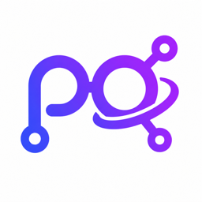
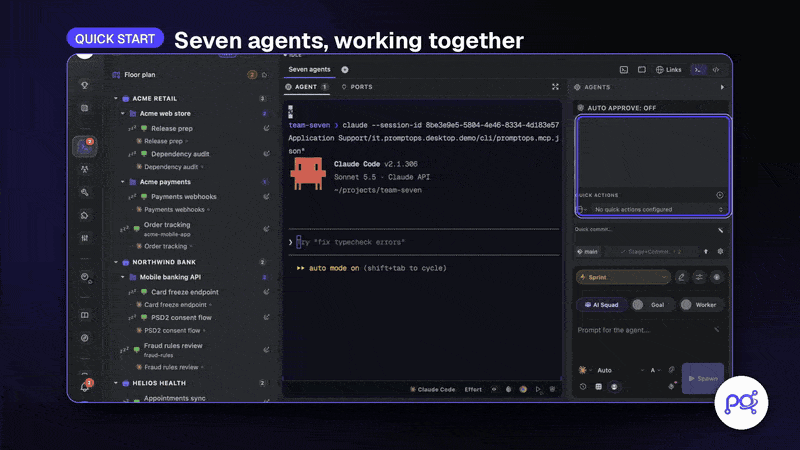
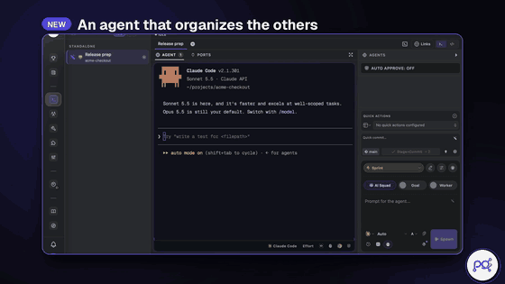
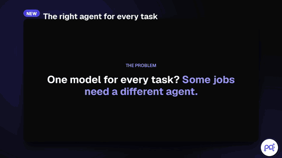
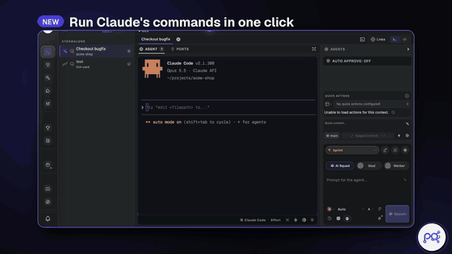
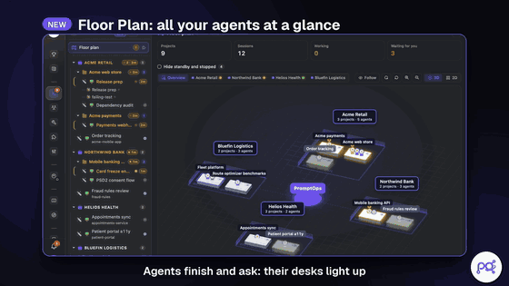
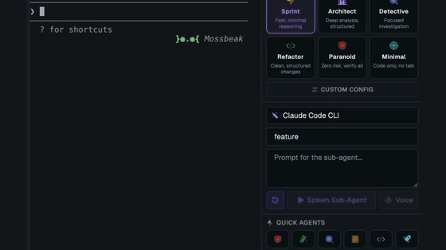
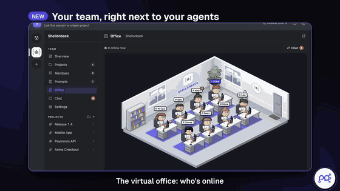

<h1 align="center">
   PromptOps
</h1>

  
  
  
  
  

  <a href="../../README.md">English</a> · <a href="README.it.md">Italiano</a> · <a href="README.fr.md">Français</a> · <a href="README.es.md">Español</a> · <a href="README.de.md">Deutsch</a> · <a href="README.pt.md">Português</a> · <a href="README.zh.md">中文</a> · <a href="README.ja.md">日本語</a> · <a href="README.ru.md">Русский</a> · <a href="README.ar.md">العربية</a> · <a href="README.hi.md">हिन्दी</a> · <b>Polski</b> · <a href="README.nl.md">Nederlands</a> · <a href="README.sv.md">Svenska</a> · <a href="README.ko.md">한국어</a>

  <strong>ADE do wielu projektów i sesji, stworzone dla CLI AI coding agents.</strong> 
  Uruchamiaj Claude Code, Codex, Gemini CLI i każdego innego agenta CLI obok siebie, uporządkowanych według klienta, projektu i sesji, na swoim komputerze i z własnymi subskrypcjami.

<h3 align="center"><a href="https://github.com/shellonback/promptops/releases/latest"><ins>Pobierz PromptOps Desktop</ins></a></h3>

  <picture><source media="(prefers-reduced-motion: reduce)" srcset="../../docs/assets/readme/seven-agents.jpg"></picture>

  Kod źródłowy edycji open source, bez konta, bez logowania i bez serwera PromptOps, wkrótce trafi do tego repozytorium. PromptOps Desktop to gotowa do uruchomienia aplikacja z Teams, synchronizacją i aplikacją mobilną. <a href="../../PRIVACY.md">Co opuszcza Twój komputer →</a>

## Szybki start

1. **[Pobierz PromptOps Desktop](https://github.com/shellonback/promptops/releases/latest)** lub uruchom `npx @shellonback/promptops`.
2. **Dodaj workspace**: wybierz folder projektu, nad którym będą pracować Twoi agenci.
3. **Rozpocznij sesję** z CLI agenta, którego już używasz (Claude Code, Codex, Gemini CLI…). PromptOps wykrywa zainstalowane.
4. **Pozwól mu otworzyć kolejnych agentów**: poproś agenta głównego *"Otwórz tu 3 agentów PromptOps: jednego do testów, jednego do README, jednego do review"*, a pojawią się obok niego, każdy przy swojej części. Claude Code i Codex automatycznie dostają serwer MCP PromptOps; każdy inny agent może zrobić to samo poleceniem `promptops ctl` w swoim terminalu.

## Funkcje

<table>
<tr>
<td width="50%" valign="middle">

### Agenci, którzy zarządzają agentami

Poproś agenta głównego o podział pracy: przez wbudowany serwer MCP otwiera jednego agenta na każdą część, zbiera ich raporty i przenosi pracę do nowej sesji. Ryzykowne działania zawsze czekają na Twoją zgodę.

</td>
<td width="50%">
  <picture><source media="(prefers-reduced-motion: reduce)" srcset="../../docs/assets/readme/agents-organize.jpg"></picture>
</td>
</tr>
<tr>
<td width="50%">
  <picture><source media="(prefers-reduced-motion: reduce)" srcset="../../docs/assets/readme/right-agent.jpg"></picture>
</td>
<td width="50%" valign="middle">

### Właściwy agent do każdego zadania

Wybierz dostawcę, model i poziom wysiłku dla każdego subagenta: Claude do refaktoryzacji, Gemini do analizy bundla, Codex do review — wszystko w jednej sesji. Tryby pracy (Sprint, Architect, Detective, Paranoid…) są mapowane na natywne flagi każdego CLI.

</td>
</tr>
<tr>
<td width="50%" valign="middle">

### Polecenia jednym kliknięciem, sesje, które przetrwają

Gdy Claude proponuje polecenie, kliknij play obok niego: uruchomi się w terminalu, a agent odczyta wynik. Zamknij i otwórz aplikację ponownie — te same sesje, ci sami agenci, w tym samym miejscu.

</td>
<td width="50%">
  <picture><source media="(prefers-reduced-motion: reduce)" srcset="../../docs/assets/readme/one-click-run.jpg"></picture>
</td>
</tr>
<tr>
<td width="50%">
  <picture><source media="(prefers-reduced-motion: reduce)" srcset="../../docs/assets/readme/floor-plan.jpg"></picture>
</td>
<td width="50%" valign="middle">

### Floor Plan

Każdy klient, każda sesja, jedno piętro. Biurka podświetlają się, gdy agent kończy pracę lub Cię potrzebuje, a piętro jest zawsze pod ręką, w 3D lub 2D, gdy pracujesz.

</td>
</tr>
<tr>
<td width="50%" valign="middle">

### Token Efficiency Engine

Gdy prompt subagenta to tylko polecenie, PromptOps proponuje uruchomić je bezpośrednio w terminalu: szybciej i bez zużywania tokenów. Każda sesja pokazuje rzeczywiste zużycie tokenów, trafienia w cache i koszt, odczytane z transkryptu agenta.

</td>
<td width="50%">
  <picture><source media="(prefers-reduced-motion: reduce)" srcset="../../docs/assets/readme/token-efficiency.jpg"></picture>
</td>
</tr>
<tr>
<td width="50%">
  <a href="https://www.promptoperations.ai/"><picture><source media="(prefers-reduced-motion: reduce)" srcset="../../docs/assets/readme/teams.jpg"></picture></a>
</td>
<td width="50%" valign="middle">

### Teams <kbd>PromptOps Desktop</kbd>

Twój zespół tuż obok Twoich agentów: wirtualne biuro, czat, tablice projektowe i sprinty. Kliknij play na zadaniu, a agent podejmie je w Twojej sesji; przeciągnij je do Gotowe, gdy testy przejdą.

Teams wymaga serwera, dlatego jest dostępne w [PromptOps Desktop](https://www.promptoperations.ai/), edycji hostowanej. W edycji open source wyświetla kłódkę i nie uruchamia żadnego kodu.

</td>
</tr>
</table>

**W zestawie także:**

- **Session Vault** — Sesje, prompty, notatki i ustawienia szyfrowane rekord po rekordzie algorytmem AES-256-GCM, z kluczem w pęku kluczy systemu operacyjnego.
- **Biblioteka promptów** — Wersjonowane prompty ze zmiennymi, kategoriami i tagami, o jedno kliknięcie od każdego agenta.
- **Pluginy budowane lokalnie** — Odizolowany host pluginów i Plugin Studio: utwórz szkielet pluginu w folderze, pozwól agentowi go napisać i przeładuj na żywo. Udostępnij go przez pull request do oficjalnego katalogu.
- **Wbudowane narzędzia deweloperskie** — Eksplorator Git i komunikaty commitów generowane przez AI, eksplorator baz danych, edytor kodu, panele Docker i portów, terminale SSH.
- **Limity dostawców pod kontrolą** — Gdy agent osiągnie limit swojego planu, PromptOps pokazuje, które inne zainstalowane CLI mogą przejąć pracę, i przełącza jednym kliknięciem.
- **Prompty głosowe na Twoim urządzeniu** — Lokalna transkrypcja Whisper; Twój własny klucz Groq lub OpenAI tylko jako zapas, jeśli go dodasz.
- **Zużycie i szybkość** — Zużycie tokenów na sesję i porównawczy test szybkości modeli, do których masz dostęp.
- **Natywna i lekka** — Rust i Tauri 2 z natywnym PTY. Bez dołączonego Chromium.

---

## Obsługiwani agenci

Działa z **dowolnym agentem CLI** — jeśli działa w terminalu, działa w PromptOps.

  <a href="https://docs.anthropic.com/en/docs/claude-code"><kbd> Claude Code</kbd></a> &nbsp;
  <a href="https://github.com/openai/codex"><kbd> Codex</kbd></a> &nbsp;
  <a href="https://github.com/google-gemini/gemini-cli"><kbd> Gemini CLI</kbd></a> &nbsp;
  <a href="https://antigravity.google"><kbd> Antigravity</kbd></a> &nbsp;
  <a href="https://docs.github.com/en/copilot/how-tos/set-up/install-copilot-cli"><kbd> GitHub Copilot</kbd></a> &nbsp;
  <a href="https://cursor.com/cli"><kbd> Cursor</kbd></a> &nbsp;
  <a href="https://x.ai/cli"><kbd> Grok</kbd></a> &nbsp;
  <a href="https://dev.meta.ai/docs/muse-code"><kbd> Muse</kbd></a> &nbsp;
  <a href="https://hermes-agent.nousresearch.com/docs/"><kbd> Hermes</kbd></a> &nbsp;
  <a href="https://docs.z.ai"><kbd> Z.AI</kbd></a> &nbsp;
  <a href="https://www.kimi.com/code"><kbd> Kimi</kbd></a> &nbsp;
  <a href="https://opencode.ai/docs/cli/"><kbd> OpenCode</kbd></a> &nbsp;
  <kbd> PromptOps CLI</kbd> &nbsp;
  <kbd>+ dowolny agent CLI</kbd>

PromptOps uruchamia oficjalne CLI z kontami, za które już płacisz. Bez proxy, bez odsprzedaży tokenów: każdy agent komunikuje się z własnym dostawcą, na jego własnych warunkach.

Nazwy produktów i logo należą do ich właścicieli. PromptOps jest niezależnym projektem, niepowiązanym z nimi ani przez nich niepopieranym.

Brakuje jakiegoś? Dodanie dostawcy to dobrze zdefiniowana zmiana — zobacz [CONTRIBUTING.md](../../CONTRIBUTING.md).

---

## Instalacja

### PromptOps Desktop — gotowy do uruchomienia

macOS, Windows i Linux. Zawiera Teams, synchronizację między urządzeniami, aplikację mobilną i SSO, a do działania wymaga konta.

- **[Pobierz z GitHub Releases](https://github.com/shellonback/promptops/releases/latest)**, z notaryzacją na macOS.
- Albo, z Node.js 18 lub nowszym: `npx @shellonback/promptops`. Instaluje i otwiera PromptOps Desktop oraz odrzuca każde pobranie, które nie jest podpisane kluczem wydań PromptOps.

Szyfruje dane Twoich sesji tym samym algorytmem co edycja open source; różnica polega na tym, że klucz przechowują nasze serwery, dzięki czemu Twoje sesje mogą podążać za Tobą. Zobacz [PRIVACY.md](../../PRIVACY.md#promptops-desktop-the-hosted-edition).

### Edycja open source

Bez konta i bez serwera: wszystko zostaje na Twoim komputerze. Jej kod źródłowy wkrótce trafi do tego repozytorium, wraz z poleceniami do samodzielnego zbudowania na macOS, Windows i Linux. Daj repozytorium [gwiazdkę](https://github.com/shellonback/promptops), aby wiedzieć, kiedy się pojawi.

---

## Społeczność &amp; wsparcie

- **Opinie &amp; pomysły:** Czegoś brakuje? [Otwórz issue](https://github.com/shellonback/promptops/issues).
- **Telegram:** wydania, eksperymenty i wczesny dostęp na [t.me/promptoperations](https://t.me/promptoperations).
- **Prywatność:** Edycja open source nie ma telemetrii, analityki ani sprawdzania aktualizacji. PromptOps Desktop wymaga konta i komunikuje się z serwerami PromptOps. [PRIVACY.md](../../PRIVACY.md) wyjaśnia, co wysyła każda edycja i dokąd.
- **Bezpieczeństwo:** Zgłaszaj podatności prywatnie, zgodnie z opisem w [SECURITY.md](../../SECURITY.md).
- **Open source i hosting:** co jest tutaj, co wymaga PromptOps Desktop i kto o tym decyduje: [GOVERNANCE.md](../../GOVERNANCE.md).
- **Wesprzyj projekt:** Daj repozytorium [gwiazdkę](https://github.com/shellonback/promptops), aby śledzić postępy.

---

## Rozwój

Chcesz pomóc? Zobacz [CONTRIBUTING.md](../../CONTRIBUTING.md). Commity są podpisywane przez sign-off ([DCO](https://developercertificate.org/)).

## Języki

[English](../../README.md), [Italiano](README.it.md), [Français](README.fr.md), [Español](README.es.md), [Deutsch](README.de.md), [Português](README.pt.md), [中文](README.zh.md), [日本語](README.ja.md), [Русский](README.ru.md), [العربية](README.ar.md), [हिन्दी](README.hi.md), **Polski**, [Nederlands](README.nl.md), [Svenska](README.sv.md) i [한국어](README.ko.md), do przełączenia z dolnego paska.

## Licencja

PromptOps jest darmowym oprogramowaniem open source na licencji [Apache License 2.0](../../LICENSE).

"PromptOps" i logo PromptOps są znakami towarowymi Shellonback S.r.l. — zobacz [TRADEMARK.md](../../TRADEMARK.md).
