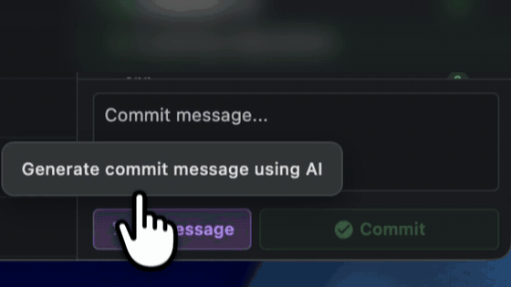
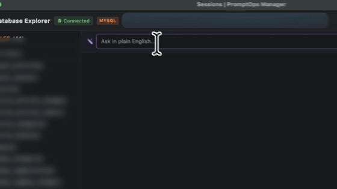
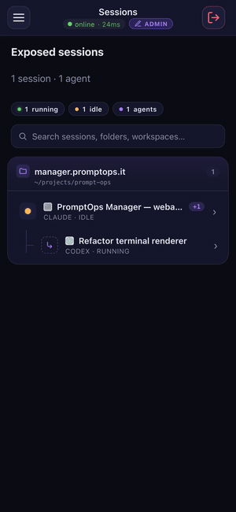

<h1 align="center">
   PromptOps
</h1>

  
  
  
  
  

  <a href="../../README.md">English</a> · <a href="README.it.md">Italiano</a> · <a href="README.fr.md">Français</a> · <a href="README.es.md">Español</a> · <a href="README.de.md">Deutsch</a> · <b>Português</b> · <a href="README.zh.md">中文</a> · <a href="README.ja.md">日本語</a> · <a href="README.ru.md">Русский</a> · <a href="README.ar.md">العربية</a> · <a href="README.hi.md">हिन्दी</a> · <a href="README.pl.md">Polski</a> · <a href="README.nl.md">Nederlands</a> · <a href="README.sv.md">Svenska</a> · <a href="README.ko.md">한국어</a>

  <strong>O ADE multiprojeto e multissessão para CLI AI coding agents.</strong> 
  Execute Claude Code, Codex, Gemini CLI e qualquer outro agente CLI lado a lado, organizados por cliente, projeto e sessão, na sua máquina e com as suas próprias assinaturas.

<h3 align="center"><a href="https://github.com/shellonback/promptops/releases/latest"><ins>Fazer download do PromptOps Desktop</ins></a></h3>

  <picture><source media="(prefers-reduced-motion: reduce)" srcset="../../docs/assets/readme/seven-agents.jpg"></picture>

  Este repositório reúne as versões do PromptOps Desktop e a edição open source: sem conta, sem login, sem servidor PromptOps, e <a href="../../README.md#open-source-edition--build-it-yourself">você mesmo a compila</a>. PromptOps Desktop é a app pronta a usar, com Teams, sincronização e a app móvel. <a href="../../PRIVACY.md">O que sai da sua máquina →</a>

## Início rápido

1. **[Faça download do PromptOps Desktop](https://github.com/shellonback/promptops/releases/latest)** ou execute `npx @shellonback/promptops`.
2. **Adicione um workspace**: escolha a pasta do projeto em que os seus agentes vão trabalhar.
3. **Inicie uma sessão** com uma CLI de agente que já usa (Claude Code, Codex, Gemini CLI…). O PromptOps identifica as que estão instaladas.
4. **Deixe-o abrir mais agentes**: peça ao agente principal *"Abra 3 agentes PromptOps aqui: um para os testes, um para o README, um para uma revisão"* e eles aparecem ao lado, cada um com a sua parte. Claude Code e Codex recebem o servidor MCP do PromptOps automaticamente; qualquer outro agente pode fazer o mesmo com o comando `promptops ctl` no seu terminal.

## Funcionalidades

<table>
<tr>
<td width="50%" valign="middle">

### Git, com uma IA que o corrige

Grafo de branches, staging e commits em cada sessão. A IA escreve a mensagem de commit a partir do seu diff e, quando um pull ou push falha, o AI Resolver guarda um ponto de backup, faz o merge, resolve os conflitos e volta a fazer push. Nunca um reset, nunca um force-push.

</td>
<td width="50%">
  <picture><source media="(prefers-reduced-motion: reduce)" srcset="../../docs/assets/readme/git-ai.jpg"></picture>
</td>
</tr>
<tr>
<td width="50%">
  <picture><source media="(prefers-reduced-motion: reduce)" srcset="../../docs/assets/readme/database-nl.jpg"></picture>
</td>
<td width="50%" valign="middle">

### Pergunte à sua base de dados em linguagem natural

O PromptOps encontra a base de dados do seu projeto (MySQL, PostgreSQL, SQLite, MongoDB) e liga-se a ela. Pergunte *"mostra todos os media do modelo CompanyProfile"*: o seu agente escreve uma consulta só de leitura, executa-a e mostra as linhas.

</td>
</tr>
<tr>
<td width="50%" valign="middle">

### Agentes que coordenam agentes

Peça ao agente principal para dividir o trabalho: através do servidor MCP integrado, ele abre um agente por parte, reúne os relatórios e move o trabalho para uma nova sessão. As ações arriscadas continuam sujeitas à sua aprovação.

</td>
<td width="50%">
  <picture><source media="(prefers-reduced-motion: reduce)" srcset="../../docs/assets/readme/agents-organize.jpg"></picture>
</td>
</tr>
<tr>
<td width="50%">
  <picture><source media="(prefers-reduced-motion: reduce)" srcset="../../docs/assets/readme/right-agent.jpg"></picture>
</td>
<td width="50%" valign="middle">

### O agente certo para cada tarefa

Escolha provider, modelo e esforço para cada sub-agente: Claude na refatoração, Gemini na análise do bundle, Codex na revisão — tudo numa só sessão. Os modos de trabalho (Sprint, Architect, Detective, Paranoid…) correspondem às flags nativas de cada CLI.

</td>
</tr>
<tr>
<td width="50%" valign="middle">

### Comandos com um clique, sessões que persistem

Quando o Claude sugere um comando, clique em play ao lado dele: o comando é executado no terminal e o agente lê o resultado. Feche e reabra a app — as mesmas sessões, os mesmos agentes, no mesmo lugar.

</td>
<td width="50%">
  <picture><source media="(prefers-reduced-motion: reduce)" srcset="../../docs/assets/readme/one-click-run.jpg"></picture>
</td>
</tr>
<tr>
<td width="50%">
  <picture><source media="(prefers-reduced-motion: reduce)" srcset="../../docs/assets/readme/floor-plan.jpg"></picture>
</td>
<td width="50%" valign="middle">

### Floor Plan

Cada cliente, cada sessão, um só andar. As mesas acendem quando um agente termina ou precisa da sua atenção, e o andar fica ao seu lado, em 3D ou 2D, enquanto trabalha.

</td>
</tr>
<tr>
<td width="50%" valign="middle">

### Token Efficiency Engine

Quando o prompt de um subagente é só um comando, o PromptOps propõe executá-lo direto no terminal: mais rápido e sem gastar tokens. Cada sessão mostra o uso real de tokens, os acertos de cache e o custo, lidos do transcript do agente.

</td>
<td width="50%">
  <picture><source media="(prefers-reduced-motion: reduce)" srcset="../../docs/assets/readme/token-efficiency.jpg"></picture>
</td>
</tr>
<tr>
<td width="50%">
  <a href="https://www.promptoperations.ai/"><picture><source media="(prefers-reduced-motion: reduce)" srcset="../../docs/assets/readme/teams.jpg"></picture></a>
</td>
<td width="50%" valign="middle">

### Teams <kbd>PromptOps Desktop</kbd>

A sua equipe bem ao lado dos seus agentes: um escritório virtual, chat, quadros de projeto e sprints. Clique em play numa tarefa e um agente assume-a na sua sessão; arraste-a para Done quando os testes passarem.

O Teams precisa de um servidor, por isso está no [PromptOps Desktop](https://www.promptoperations.ai/), a edição hospedada. Na edição open source aparece com um cadeado e não executa código.

</td>
</tr>
<tr>
<td width="50%" valign="middle">

### PromptOps Remote <kbd>PromptOps Desktop</kbd>

**Suas sessões, também no celular.** Com o app PromptOps Remote você vê ao vivo as sessões e agentes do desktop, responde quando um agente espera seu input e, se permitir, digita ou dita prompts pelo celular. Pareamento pelo QR do desktop, sem abrir portas.

</td>
<td width="50%" align="center">
  <picture><source media="(prefers-reduced-motion: reduce)" srcset="../../docs/assets/readme/remote.jpg"></picture>
</td>
</tr>
</table>

**Também incluído:**

- **Session Vault** — Sessões, prompts, notas e configurações criptografados item a item com AES-256-GCM, com a chave no keychain do seu sistema.
- **Biblioteca de prompts** — Prompts versionados com variáveis, categorias e tags, a um clique de qualquer agente.
- **Plugins criados localmente** — Um host de plugins em sandbox e o Plugin Studio: crie a estrutura de um plugin numa pasta, deixe um agente escrevê-lo e recarregue-o ao vivo. Envie-o ao catálogo oficial com um pull request.
- **Ferramentas de desenvolvimento integradas** — Editor de código, painéis de Docker e portas, terminais SSH.
- **Limites dos providers, resolvidos** — Quando um agente atinge o limite do plano, o PromptOps mostra que outras CLIs instaladas podem assumir e troca com um clique.
- **Prompts por voz no seu dispositivo** — Transcrição local com Whisper; a sua própria chave Groq ou OpenAI apenas como alternativa, se adicionar uma.
- **Uso e velocidade** — Consumo de tokens por sessão e um teste de velocidade lado a lado dos modelos a que tem acesso.
- **Nativo e leve** — Rust e Tauri 2 com PTY nativo. Sem Chromium embutido.

---

## Agentes suportados

Funciona com **qualquer agente de CLI** — se funciona num terminal, funciona no PromptOps.

  <a href="https://docs.anthropic.com/en/docs/claude-code"><kbd> Claude Code</kbd></a> &nbsp;
  <a href="https://github.com/openai/codex"><kbd> Codex</kbd></a> &nbsp;
  <a href="https://github.com/google-gemini/gemini-cli"><kbd> Gemini CLI</kbd></a> &nbsp;
  <a href="https://antigravity.google"><kbd> Antigravity</kbd></a> &nbsp;
  <a href="https://docs.github.com/en/copilot/how-tos/set-up/install-copilot-cli"><kbd> GitHub Copilot</kbd></a> &nbsp;
  <a href="https://cursor.com/cli"><kbd> Cursor</kbd></a> &nbsp;
  <a href="https://x.ai/cli"><kbd> Grok</kbd></a> &nbsp;
  <a href="https://dev.meta.ai/docs/muse-code"><kbd> Muse</kbd></a> &nbsp;
  <a href="https://hermes-agent.nousresearch.com/docs/"><kbd> Hermes</kbd></a> &nbsp;
  <a href="https://docs.z.ai"><kbd> Z.AI</kbd></a> &nbsp;
  <a href="https://www.kimi.com/code"><kbd> Kimi</kbd></a> &nbsp;
  <a href="https://opencode.ai/docs/cli/"><kbd> OpenCode</kbd></a> &nbsp;
  <kbd> PromptOps CLI</kbd> &nbsp;
  <kbd>+ qualquer agente de CLI</kbd>

O PromptOps inicia as CLIs oficiais com as contas que já paga. Sem proxy, sem revenda de tokens: cada agente comunica com o seu próprio provider, segundo os termos desse provider.

Os nomes e logos dos produtos pertencem aos seus respectivos proprietários. O PromptOps é um projeto independente, não afiliado nem endossado por eles.

Falta algum? Adicionar um provider é uma alteração bem definida — consulte [CONTRIBUTING.md](../../CONTRIBUTING.md).

---

## Instalação

### PromptOps Desktop — pronto a usar

macOS, Windows e Linux. Inclui Teams, sincronização entre dispositivos, a app móvel e SSO, e requer uma conta.

- **[Fazer download no GitHub Releases](https://github.com/shellonback/promptops/releases/latest)**, notarizado no macOS.
- Ou, com Node.js 18 ou mais recente: `npx @shellonback/promptops`. Instala e abre o PromptOps Desktop, e recusa qualquer download que não esteja assinado com a chave de release do PromptOps.

Criptografa os dados das suas sessões com o mesmo algoritmo da edição open source; a diferença é que a chave fica nos nossos servidores, para que as suas sessões o acompanhem entre dispositivos. Consulte [PRIVACY.md](../../PRIVACY.md#promptops-desktop-the-hosted-edition).

### Edição open source

Sem conta e sem servidor: tudo fica no seu computador. O código está neste repositório; não há binários pré-compilados desta edição: os comandos para compilá-la no macOS, Windows e Linux estão no [README em inglês](../../README.md#open-source-edition--build-it-yourself).

---

## Comunidade &amp; Suporte

- **Feedback &amp; ideias:** Falta alguma coisa? [Abra uma issue](https://github.com/shellonback/promptops/issues).
- **Telegram:** releases, novidades experimentais e acesso antecipado em [t.me/promptoperations](https://t.me/promptoperations).
- **Privacidade:** A edição open source não tem telemetria, nem analytics, nem verificação de atualizações. O PromptOps Desktop requer uma conta e comunica com os servidores do PromptOps. O [PRIVACY.md](../../PRIVACY.md) explica o que cada edição envia e para onde.
- **Segurança:** Comunique vulnerabilidades de forma privada, como descrito em [SECURITY.md](../../SECURITY.md).
- **Open source e hospedado:** o que está aqui, o que precisa do PromptOps Desktop e quem decide: [GOVERNANCE.md](../../GOVERNANCE.md).
- **Mostre o seu apoio:** Dê uma [estrela](https://github.com/shellonback/promptops) ao repositório para acompanhar o projeto.

---

## Desenvolvimento

Quer contribuir? Consulte [CONTRIBUTING.md](../../CONTRIBUTING.md). Os commits levam sign-off ([DCO](https://developercertificate.org/)).

## Idiomas

[English](../../README.md), [Italiano](README.it.md), [Français](README.fr.md), [Español](README.es.md), [Deutsch](README.de.md), **Português**, [中文](README.zh.md), [日本語](README.ja.md), [Русский](README.ru.md), [العربية](README.ar.md), [हिन्दी](README.hi.md), [Polski](README.pl.md), [Nederlands](README.nl.md), [Svenska](README.sv.md) e [한국어](README.ko.md), alternáveis na barra inferior.

## Licença

O PromptOps é gratuito e open source sob a [Apache License 2.0](../../LICENSE).

"PromptOps" e o logótipo PromptOps são marcas comerciais da Shellonback S.r.l. — consulte [TRADEMARK.md](../../TRADEMARK.md).
